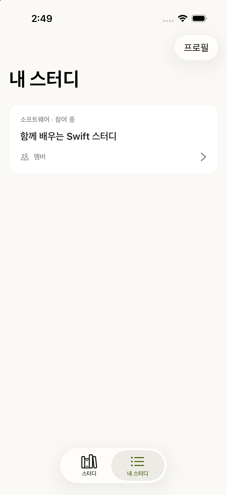
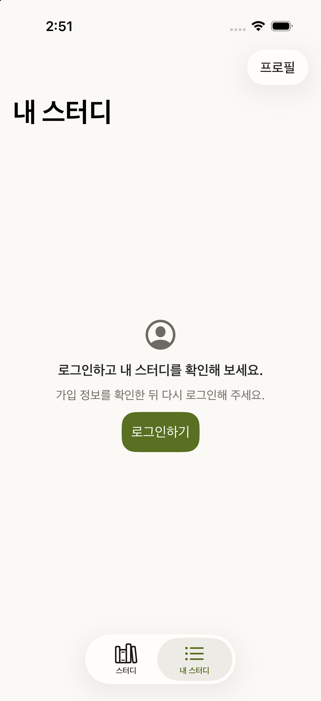
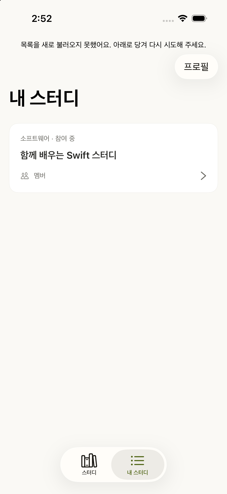

# 내 스터디 실제 root 통합 검토 · 2026-10-22

실행 후보는 `93faaf1420a37391ef1315d68eb18254ce3928de`다. main 재배치 후보 `d452a453`와 전체 ios tree `37639c9d` 및 own binary patch가 정확히 같다. 재배치와 이 증거 추가를 새 hash의 재실행으로 표시하지 않는다.

독립 QA는 Root7·목록 Integration6·Setting 취소/flag2, 총15개를 직렬 실행해 통과했고 ordinary Debug·Release build exit0을 확인했다. 이전 Data epoch 경계의11+4개 통과는 해당 코드가 같은 별도 후보의 근거다. 서로 다른 후보의 검사를 하나의 전체 테스트 실행으로 합치지 않는다.

실제 Root/MemberArea/목록 VC/VM을 쓰는 비출하 host에서 SceneDelegate·Factory의 Domain 입력·bundle ID 세 곳만 다르다. QA가 원본103파일을 대조하고 package 설치112파일을 확인했다. SDK·네트워크·credential은 없으며 법적 문구 guard는 그대로다.

디자이너가 같은 iPhone17Pro/iOS26.5/보통 글자 크기의 실제 조작으로 확인했다.

| 범위 | 관찰 |
|---|---|
| 6개 기본 상태 | loading/content/empty/failure/guest/unavailable이 구분되고 개인 카드가 필요한 상태에서만 보인다. |
| 인증 OFF·403·반복 거부 | OFF는 unavailable, guest403은 구체 가입 안내, 같은 회원의 반복 거부는 failure와 명시 재시도 안내를 유지한다. 요청 상한은 QA 단위검사 근거다. |
| refresh 실패·빈 성공 | 실패는 기존 카드와 상단 안내를 유지하고, 빈 성공은 카드·선택을 지운다. |
| 로그인·로그아웃 | 프로필 로그인은 프로필에 남고 닫으면 원래 목록을 표시한다. 게이트 취소·성공은 같은 내 스터디 탭으로 돌아간다. 로그아웃은 private 목록을 지운다. |
| 상세·두 탭 | stable ID가 기존 공개 Detail로 이동하며 두 탭의 서로 다른 상세 stack과 뒤로 복귀를 유지한다. 통제 목록 제목과 공개 Mock 상세 제목의 일치를 실제 서버 근거로 쓰지 않는다. |
| 복원 | ordinary 앱을 UI로 Mock/기본 flag 상태에 복원하고 cold launch 뒤 유지됨을 확인했다. 데이터 삭제·기기 reset은 하지 않았다. |

기본6상태와 추가 인증 OFF/403/반복 거부/refresh 실패/빈 성공, 총11입력의 원본은 독립 디자인 증거에서 보존한다. 아래3개는 대표 캡처다. 빗나간 탭과 분리 gesture 입력의 실패 프레임은 성공 근거로 제외했고, 실제 당김 결과는 한 WebSocket 연결의 입력과 안정된 화면으로 확인했다.

| 회원 콘텐츠 | 403 가입 안내 |
|---|---|
|  |  |

로컬 통합·시각 범위는 독립 QA·디자인·head가 수락했다. 실제 OAuth·인증된 GET200 decoding·실제 서버 목록 일치·법적 승인·배포 QA·Ready 활성화는 미확인이다. 픽셀 일치율, 확대 글자·VoiceOver 전용 QA, 애니메이션 시간은 측정하지 않았다. `study.my-studies`는 InProgress 기본 OFF이며 SC69는 별도 Draft 게이트다.
