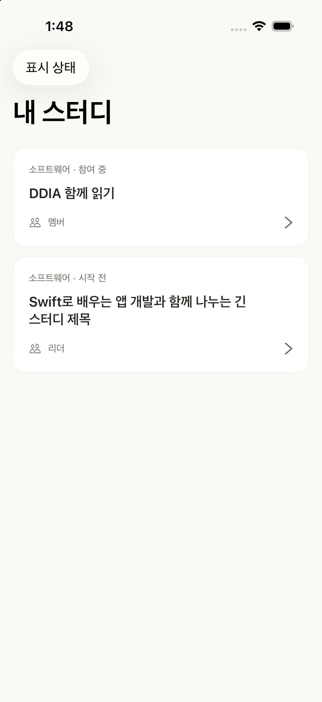
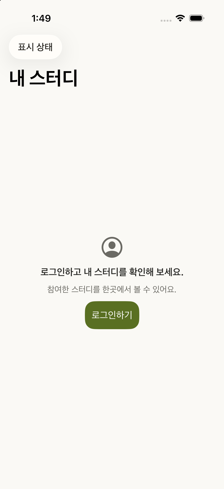

# 내 스터디 View 표시 검토

2026-10-22, 표시 후보 `656cc1232b651848f8c72eec60306176e7987c26`의 controlled native host에서 캡처했다. 실제 ViewModel·ViewController·cell은 후보와 동일하고 SceneDelegate의 6상태 메뉴와 bundle ID만 다르다. 화면의 스터디와 회원 정보는 표시용 데이터다. 실서비스 참여 정보·로그인·API·최종 root 연결 증거가 아니다.

독립 QA의 MyStudiesListDisplayTests 2개가 통과했다. 디자인 검토는 loading/content/empty/failure/guest/unavailable 원본 6상태를 직접 확인했으며, 보통 글자 크기에서 제목·상태 영역의 safe area 침범과 문구 잘림을 발견하지 않았다. 이 PR의 View 범위만 수락됐다. 대표 캡처 두 개를 원본 그대로 보존한다.

| 콘텐츠 | 비회원 |
|---|---|
|  |  |

캡처 뒤 이 자료를 추가한 커밋은 iOS 소스와 테스트를 바꾸지 않는다. 최종 app root와 로그인 성공/취소·refresh·실제 API는 SC68에서 별도 검증한다.
