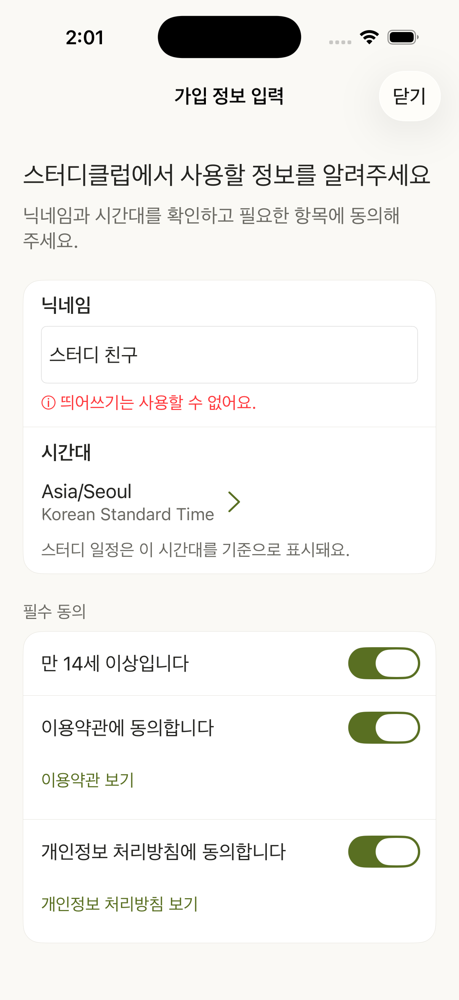
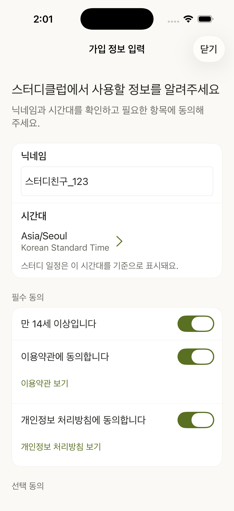

# SC-179 닉네임 입력 오류 안내

- 기준: origin/main e1f2f42에서 분기한 boa/sc-179의 닉네임 변경분.
- iPhone 17 Pro, iOS 26.0.1 Simulator, Debug 빌드.
- 저장소 밖 임시 실행본에서 실제 OnboardingViewController와 OnboardingViewModel을 사용했다. SceneDelegate만 가입 화면을 직접 열도록 바꾸고 약관 제출 허용값과 필수 동의를 제어했다. 실제 가입이나 서버 요청은 하지 않았다.
- UIKit 입력 변경 이벤트, 포커스 종료, setMarkedText/unmarkText를 이용한 38개 확인 항목이 통과했다. 결과는 ui-checks.json이다.
- 정상 문자와 _, 공백(앞·중간·뒤·연속·유니코드), 특수문자, 이모지, 빈 입력 후 포커스 종료, 오류 수정, 한글 조합 중 오류 숨김과 완료 후 검사를 확인했다.
- UITextField는 입력된 줄바꿈을 공백으로 바꿨다. 폭이 없는 공백도 공백 오류로 차단됐다.
- 실제 키보드 타이핑과 실서비스 가입은 확인하지 않았다. 캡처는 제어된 UIKit 실행 결과이며 실제 인증 경로의 증거가 아니다.
- 제품 소스의 관련 XCTest 42개 통과. 직렬 실행 및 지정된 기존 Simulator를 사용했다.

| 공백 오류 | 특수문자 오류 | 정상 입력 |
|---|---|---|
|  |  |  |

재현 명령:

```sh
xcodebuild -project ios/studyclub.xcodeproj -scheme studyclub -configuration Debug \
  -destination 'platform=iOS Simulator,id=0B5CC97A-C105-4FA5-8E61-1DD1269E2112' \
  -parallel-testing-enabled NO \
  -only-testing:studyclubTests/OnboardingViewModelTests \
  -only-testing:studyclubTests/MemberAreaViewModelTests \
  -only-testing:studyclubTests/SettingAccountViewModelTests \
  CODE_SIGNING_ALLOWED=NO test
```
