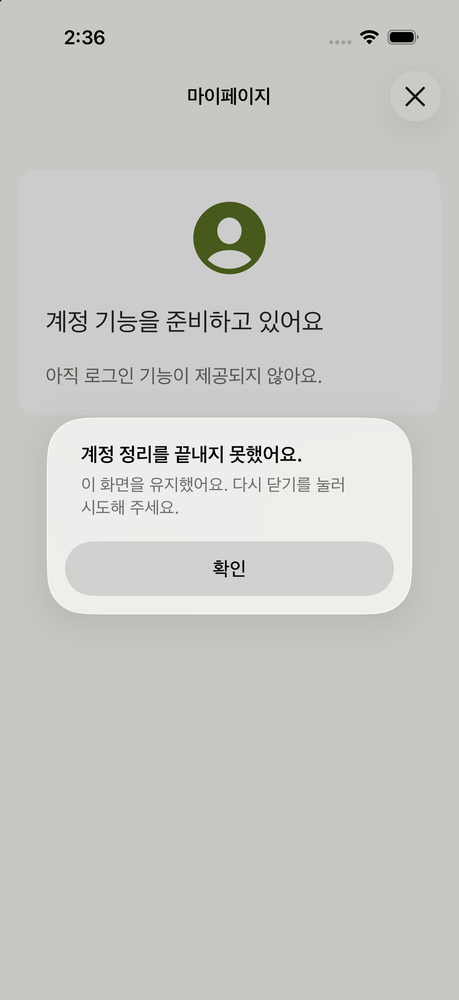
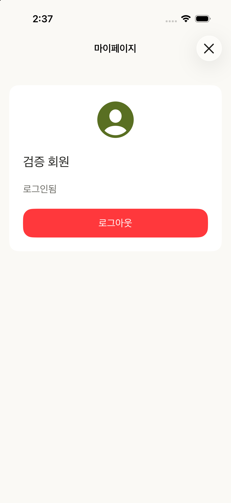
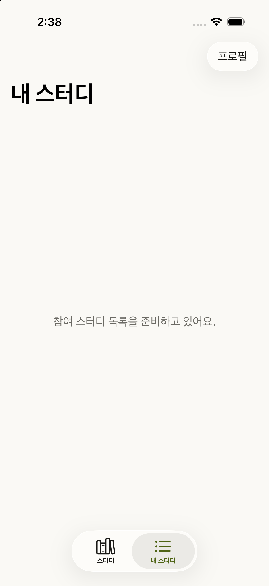

# PR9 인증 통합 검토 · 2026-10-22

검증 후보는 `58695ef54d7025f3a92edb415a799c491609418b`다. 독립 QA의 ordinary Debug·Release build가 exit0이며 Debug 설치112파일이 package와 일치했다. 이 자료 추가는 iOS 코드와 테스트를 바꾸지 않는다.

비출하 actual-root host는 실제 Root·Setting·Profile 소스를 유지하고 SceneDelegate, RepositoryFactory의 Auth fixture, bundle ID 세 곳만 다르다. 기본 모드는 정리 실패, `--member-success` 모드는 Domain 회원 성공과 정상 정리다. 실제 SDK·서버·credential은 사용하지 않는다. 법적 문구 승인 guard도 그대로다.

| 경계 | 직접 확인 |
|---|---|
| Auth OFF 정리 실패 뒤 프로필 닫기 | 프로필과 정리 실패 오류를 유지한다. 확인 후 X 재시도도 같은 실패를 유지한다. |
| 프로필에서 로그인 성공 | 확인된 주입 nickname 카드로 돌아와 프로필에 남는다. X는 원래 Study 탭으로 돌아간다. |
| 내 스터디 게이트에서 로그인 성공 | 원래 내 스터디 탭의 회원 안내로 돌아간다. 실제 LIST와 refresh는 SC68 범위다. |

| 프로필에서 시작한 성공 | 게이트에서 시작한 성공 |
|---|---|
|  |  |

수정 전979c6ce의 같은 실패 경로에서는 Main으로 잘못 닫혔다. 실제 자식 navigation이 있을 때만 자식을 닫도록 두 조건을 고친 뒤 같은 경로에서 오류 보존을 재확인했다. 카드6상태와 일반 guest/cancel·두 루트 진입·tab stack 보존은979의 원본 조작 근거를 재사용한다. 두 guard와 사양 설명 외 Root·카드·취소 코드가 같으며 새586에서 모든 과거 경로를 다시 실행했다는 뜻은 아니다.

이 정확 후보의 로컬 프로필 통합 범위는 독립 QA·디자인 검토 뒤 수락됐다. 실제 OAuth·인증된 API 응답·약관 승인·SC68 목록 갱신·배포 Ready는 미확인이다. 기존 mypage/sc-94-review 폴더는 원본 PR9의 역사적 근거로 보존한다.
